# Campus Eats

## Overview

Campus Eats is a Python-based campus food ordering system. This project will enable the user to view different campus cafes, browse their menu items, add various food items to the cart, update or remove them, place the order, view the bill, and see the order history during the session of the program.

The given project is a console-based application, which uses Python as its programming language.

## Features

* View available campus cafes
* View menu items and their prices
* Add items to the cart
* Remove items from the cart
* Update item quantities
* View cart and total amount
* Generate a bill for an order
* Place an order with a unique Order Id
* View order history during the current program session
* Input validation of menu and quantity selections*

## Technologies used

* Python 3
* Python functions
* Python dictionaries and lists
* Console-based input/output

## Project structure

Campus-Eats/

* cafe.py
* cart.py
* billing.py
* menu_data.py
* order.py
* README.md
* statement.md
* .gitignore

### Files description

File name | Description |

|`cafe.py` | Contains the main program and user interaction |
|`cart.py` | Contains all functions for working with the cart |
|`billing.py` | Contains all functions for generating the bill |
|`menu_data.py` | Contains necessary information about cafes and their menu items |
|`order.py` | Contains all functions for placing an order and maintaining an order Id |
|`README.md` | Contains information about the project |
|`statement.md` | Contains information about the problem and the project scope |
|.gitignore | Contains information about ignored folders and files |

## How to run

### 1. Install Python

Make sure that Python 3 is installed on your computer.

### 2. Open the project folder

Open the project folder in VS Code or any other editor of your choice, which supports Python.

### 3. Run the main file

Run the following command:

python cafe.py

This will launch the Campus Eats main menu in the terminal.

## How to use

Once you have launched the program, you will see the following commands:

1. View Cafes & Menu
2. Add Item to Cart
3. Remove Item from Cart
4. Update Quantity
5. View Cart
6. Place Order
7. Order History
8. Exit

You will be able to use these commands by entering the corresponding digit.

### Order history

Order history is only maintained during a program session. Once the program is closed, it is deleted for the next launch.

## Testing

The following cases can be tested manually:

* View the list of cafes
* Open a cafe menu
* Add an item to the cart
* Add the same item multiple times
* Remove an item from the cart
* Update item quantity
* Try to enter an invalid menu choice
* Try to enter an invalid quantity
* Try to place an order with an empty cart
* Place a valid order
* Check the generated Order Id
* View order history after placing an order
* Exit the program and run it again to confirm that previous order history is not retained

## Future enhancements
The following features can be added to the application:

* User log in and profiles
* Online payment
* Order status
* Search/filter options
* Permanent order history
* Admin panel for managing menus

## Screenshots

## Screenshots

### Screenshot 1
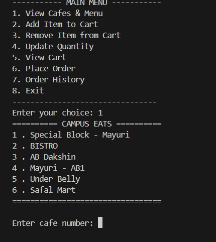

### Screenshot 2
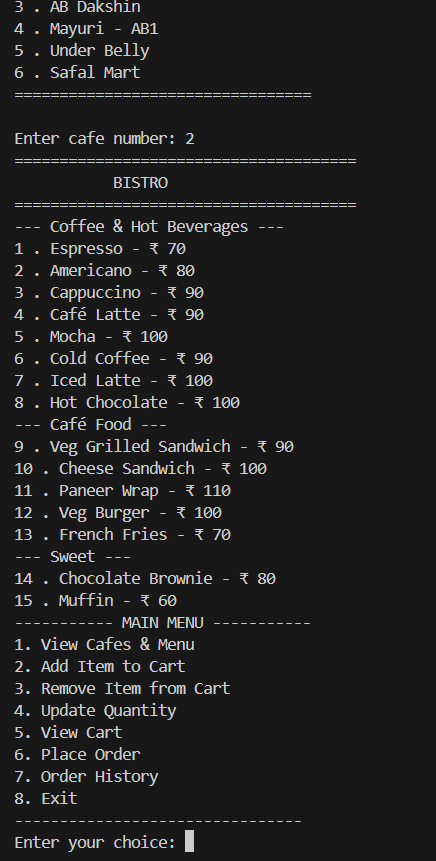

### Screenshot 3
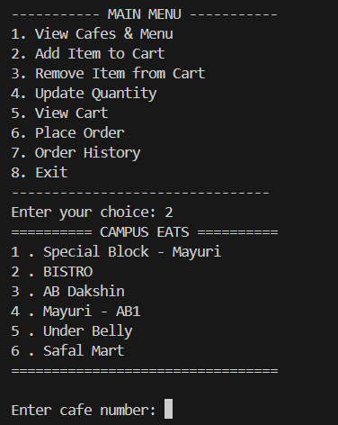

### Screenshot 4
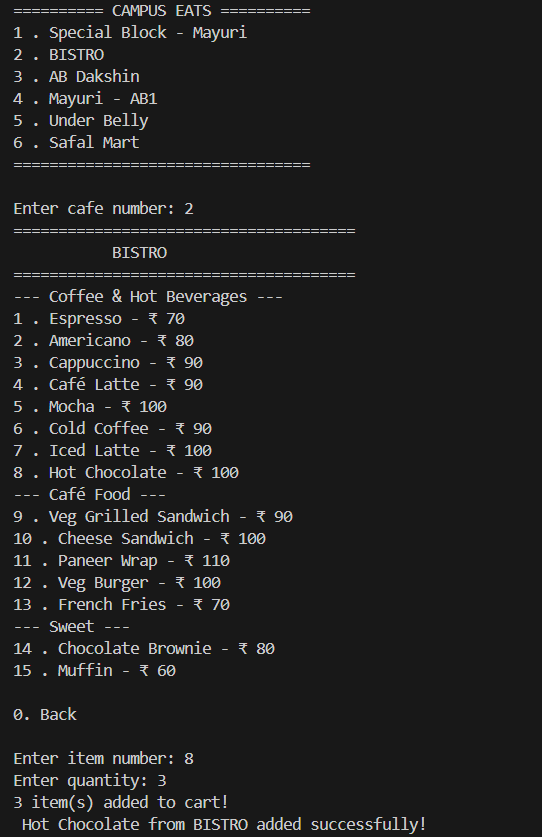

### Screenshot 5
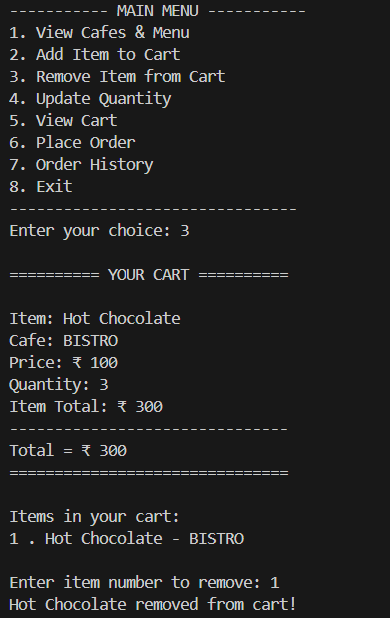

### Screenshot 6
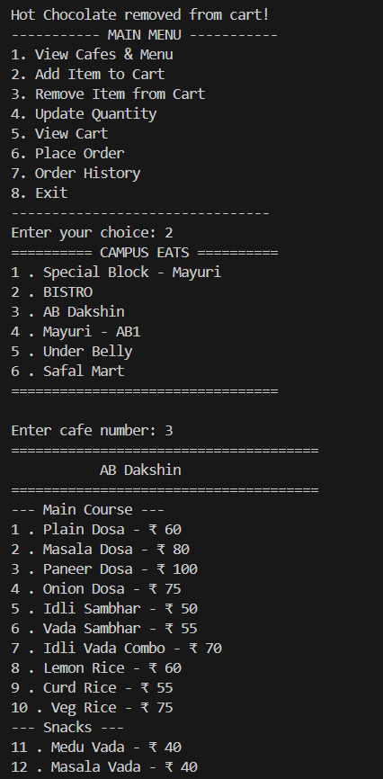

### Screenshot 7
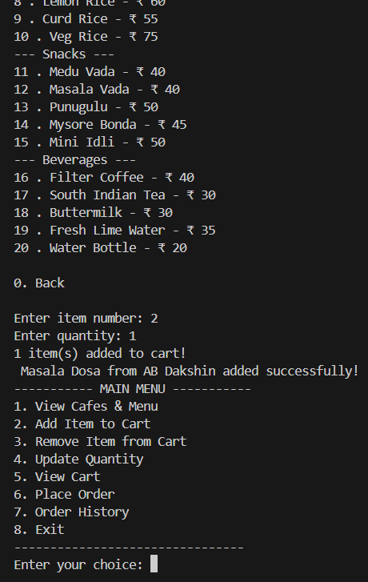

### Screenshot 8
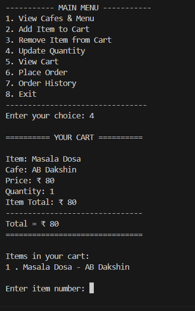

### Screenshot 9
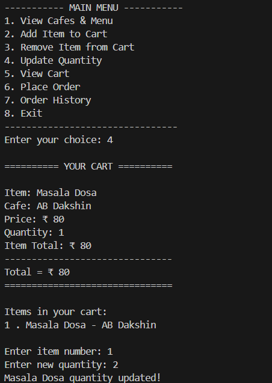

### Screenshot 10
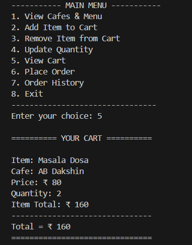

### Screenshot 11
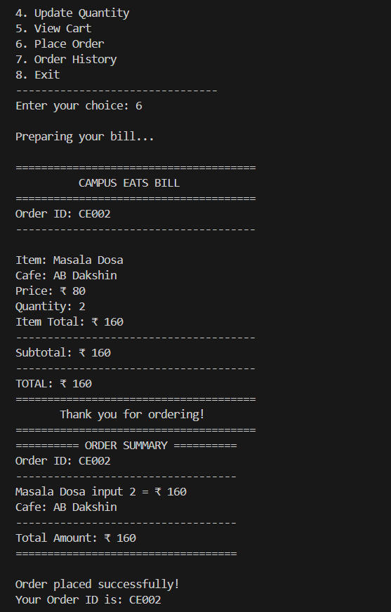

### Screenshot 12
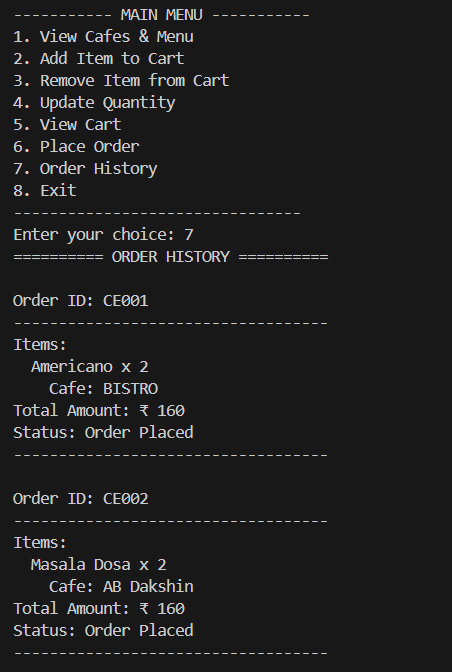

### Screenshot 13
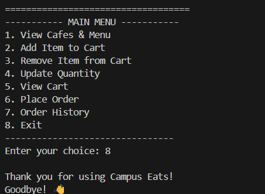